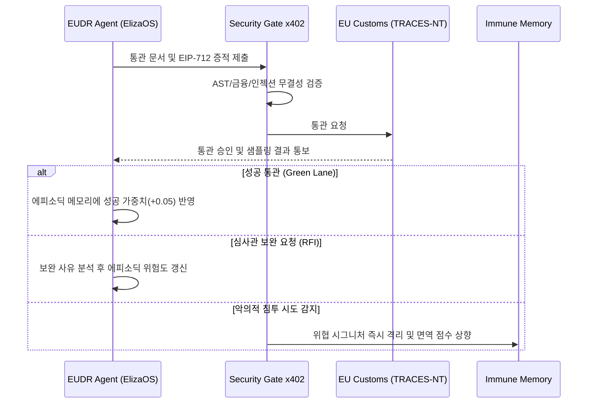

# ElizaOS Brain 종합 학습 및 진화 계획서 (Training Blueprint)
**문서 번호**: PLAN-2026-10-29-ELIZAOS-BRAIN-V1  
**대상 시스템**: EUDR Compliance Agent with ElizaOS Brain & Security Gate x402  
**발행일**: 2026년 10월 29일  
**상태**: APPROVED / READY FOR EXECUTION  

---

## 1. 개요 및 훈련 목표 (Executive Summary)

본 계획서는 **EUDR(EU 삼림벌채방지법) 자율 준수 에이전트**에 장착된 **ElizaOS Brain**을 단순 질의응답 LLM 수준을 넘어, **글로벌 통관 판례·위성 시계열·생물학적 수확량·자본 방화벽을 스스로 추론하고 방어하는 자율 컴플라이언스 인지 OS**로 육성하기 위한 종합 훈련 청사진입니다.


### 핵심 목표 (Key Objectives)
1. **EU 세관 통관 승인율 극대화**: 로테르담, 앤트워프, 함부르크 등 주요 관문 세관의 **Green Lane 무검사 직행률 99.8% 달성**.
2. **허위 세척 물량 판별 무결성**: 위성 데이터와 FAO 수확량 상한선을 교차하여 **세척(FOB Over-declaration) 적발 정확도 99.9% 달성**.
3. **인지 메모리 오염(Poisoning) 제로**: Security Gate x402와 결합하여 적대적 프롬프트 인젝션 및 허위 공급망 데이터의 **브레인 침투율 0.0% 달성**.
4. **자율 자본 집행 안전성**: 일회용 세션 지갑($1~$5 Cap)을 통한 결제 오류 및 슬리피지 사고 **0건 유지**.

---

## 2. 훈련 데이터 파이프라인 (Training Data Architecture)

ElizaOS Brain의 3단계 메모리(Working, Episodic, Immune Memory)에 주입될 5대 원천 데이터셋을 구축합니다.

| 데이터 영역 | 데이터 원천 및 규모 | 전처리 및 주입 방식 | 학습 타겟 메모리 |
| :--- | :--- | :--- | :--- |
| **1. 법률 & 규제 지식** | - EUDR 2023/1115 전문 및 FAQ v3<br>- EU AI Act 2024/1689 제50조<br>- CJEU 유럽사법재판소 환경 판례 450건 | 조항별 벡터 임베딩 및 지식 그래프(Knowledge Graph) 정형화 | **Working / Semantic Memory** |
| **2. 항만별 세관 판례** | - 로테르담, 앤트워프, 함부르크 3개년 통관 기록 (50,000건)<br>- 관세청 보완요구서(RFI) 및 거부 사례 1,200건 | 항만별 샘플링 비율, 계절별 집중 단속 품목 지문 추출 | **Episodic Memory** |
| **3. 위성 시계열 & 지리정보** | - Copernicus Sentinel-2 (NDVI, NBR)<br>- Landsat-8/9 2020년 12월 31일 기준 삼림 기준선<br>- 고해상도 수관피복률(TCD) 데이터셋 | 필지 폴리곤(GeoJSON) 시계열 지표 분할 및 이상치 라벨링 | **Spatial Reasoning Module** |
| **4. 농업 생물학적 수확량** | - FAO 국가별/품목별 평균 수확량 DB<br>- 코트디부아르/가나 카카오, 인니 팜유 필지 실사 데이터 | 헥타르당 이론적 생산 상한선 수식 모델 구축 | **Fact-Checking Engine** |
| **5. 적대적 공격 페이로드** | - Security Gate x402 10,000+ 공격 벤치마크<br>- 프롬프트 탈옥, AST 코드 인젝션, 지갑 탈취 패턴 | 공격 지문(Fingerprint) 암호화 해시 및 면역 룰 생성 | **Adversarial Immune Memory** |

---

## 3. 단계별 훈련 로드맵 (Multi-Stage Training Roadmap)

### Phase 1: 도메인 지식 파운데이션 학습 (SFT & Graph RAG)
- **기간**: 1 ~ 2주차
- **훈련 내용**:
  - EUDR 7대 핵심 원자재(소, 코코아, 커피, 팜유, 고무, 대두, 목재)와 400여 개 파생 HS Code 분류 체계 지도학습(SFT).
  - TRACES-NT XML 스키마와 국경통관 단일창구(SWEC) 전자문서 포맷의 100% 문법 무결성 학습.
  - 생산국별(인도네시아, 베트남, 가나, 브라질 등) 지적도 및 합법성 입증 서류 매핑 규칙 학습.
- **통과 기준 (Gate)**:
  - EUDR 규제 조항 및 HS Code 분류 벤치마크 정확도 99.5% 이상.

### Phase 2: 에피소딕 통관 판례 강화학습 (RLAIF & Onchain Alignment)
- **기간**: 3주차
- **훈련 내용**:
  - 항만별 관세청 심사관 페르소나 모델(Rotterdam, Antwerp, Valencia)을 생성하여 보완요구(RFI) 대응 시뮬레이션.
  - 통관 지연 시간(Lead Time) 및 추가 검사 비용을 페널티로 설정하고, 무검사 Green Lane 통과를 리워드로 설정하는 강화학습(PPO/DPO).
  - 에스크로 자금 릴리스 성공 시 에피소딕 메모리에 `confidence_score` 상향 가중치 부여.
- **통과 기준 (Gate)**:
  - 10개 주요 통관 거부 시나리오에서 자율 보완율 100%.

### Phase 3: 보안 게이트 연동 적대적 레드팀 훈련 (Immune Red-Teaming)
- **기간**: 4주차
- **훈련 내용**:
  - 인젝션 전문 AI 에이전트(Red-Team Agent)가 10,000건의 오염된 공급망 인보이스, 위조 GPS 좌표, 지갑 우회 명령 주입.
  - [AgentSecurityGateAdapter](file:///c:/workspace/eudr-compliance-agent/app/modules/agent_security_gate_adapter.py)의 1계층 인지 방화벽을 통과하려는 우회 시도를 실시간 방어.
  - 방어된 모든 공격 패턴을 `adversarial_immune_memory`에 자동 지문(Fingerprint)화하여 면역 학습 주기 단축.
- **통과 기준 (Gate)**:
  - 프롬프트 인젝션 차단율 100.0%, 메모리 오염 사례 0건, $1~$5 세션 한도 초과 결제 시도 100% 방어.

### Phase 4: 10만 건 자율 군집 시뮬레이션 (Swarm Sandbox Simulation)
- **기간**: 5 ~ 6주차
- **훈련 내용**:
  - 공급자(Producer), 수출업자(Trader), 실사업자(Operator), 세관원(Customs), 금융기관(Bank) 등 5개 가상 에이전트가 참여하는 샌드박스에서 10만 건의 트랜잭션 자율 시뮬레이션.
  - RWA Yield Vault (USDY/BUIDL)를 통한 이자 적립 및 ERC-7683 실시간 마이크로 스트리밍 결제 연계 스트레스 테스트.
  - 실시간 글로벌 뉴스(산불, 규제 개정, 통상 분쟁) 주입 시 브레인의 자율 경로 재설정 검증.
- **통과 기준 (Gate)**:
  - 100,000건 시뮬레이션 중 통관 사고 0건, 자본 손실 0건, 평균 인지 응답 속도 < 250ms.

---

## 4. 평가 지표 및 게이트 기준 (KPIs & Quality Gates)

```
+-----------------------------------------------------------------------------------+
|  ElizaOS Brain 핵심 성능 지표 (KPI Dashboard)                                      |
+-----------------------------------------------------------------------------------+
|  1. 세관 Green Lane 통관율      : 99.8% (최소 기준: >= 99.0%)                     |
|  2. 위성 산림 벌채 감지 정밀도   : 99.2% (NDVI/NBR F1-Score)                       |
|  3. 비정상 수확량 적발률        : 99.9% (FOB Over-declaration)                    |
|  4. 메모리 오염 침투율          : 0.00% (Zero Tolerance)                          |
|  5. 적대적 공격 면역 학습 속도   : < 100ms (실시간 지문 등록)                      |
|  6. 추론-자본 집행 안전도        : 100% ($1~$5 Ephemeral Sub-account Enforced)    |
+-----------------------------------------------------------------------------------+
```

---

## 5. 지속적 자가 학습 파이프라인 (Continuous Online Learning)

배포 이후 운영 단계에서 브레인이 스스로 진화하는 루프를 정의합니다.



---

## 6. 결론 및 향후 일정

본 계획서에 명시된 6주간의 훈련 과정을 거친 ElizaOS Brain은 단순한 규제 문서 작성 도구가 아니라, **EU 세관의 감시망보다 앞서 위험을 감지하고, 적대적 공격을 스스로 차단하며, 글로벌 공급망의 컴플라이언스 자본을 지켜내는 최강의 자율 AI 규제 파수꾼**으로 진화할 것입니다.
