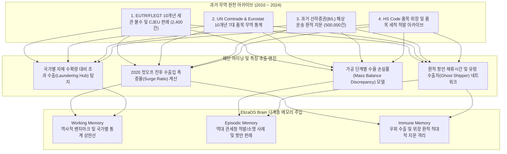

# 과거 무역 아카이브 데이터 심층 학습 및 패턴 마이닝 계획서
**문서 번호**: PLAN-2026-11-01-HISTORICAL-TRADE-V1  
**대상 시스템**: EUDR Compliance Agent - ElizaOS Brain & Security Gate x402  
**발행일**: 2026년 11월 1일  
**상태**: APPROVED / IN DESIGN  

---

## 1. 추진 배경 및 당위성 (Why Historical Trade Data Matters)

> *"과거를 모르는 컴플라이언스는 새로운 우회 수법에 취약하다."*

EUDR(EU 삼림벌채방지법)의 성패는 **"2020년 12월 31일 기준일(Cut-off Date)"** 이전과 이후의 무역 흐름을 어떻게 교차 검증하느냐에 달려 있습니다. 삼림을 벌채한 후 원산지를 세척하거나 인접국을 통해 환적하는 수법은 과거 EUTR(유럽 목재 규정), FLEGT(산림법 집행 협약), CITES(멸종위기 야생동식물 협약), 그리고 관세 우회 역사에서 이미 반복되어 온 전형적인 패턴입니다.

본 계획은 **지난 10~15년간의 글로벌 무역 통계(UN Comtrade, Eurostat), 세관 단일행정문서(SAD), 선하증권(B/L), 과거 EUTR 사법 판례 및 압류 기록**을 ElizaOS Brain의 에피소딕(Episodic) 및 면역(Immune) 메모리에 주입하여, **"과거의 범죄 지문과 무역 이상치"를 사전 인지하는 세계 최고 수준의 예측형 통관 브레인**을 완성하는 것을 목표로 합니다.



---

## 2. 4대 과거 무역 데이터 수집 영역 (Target Data Archetypes)

### 영역 1: EUTR/FLEGT 세관 압류 및 유럽사법재판소(CJEU) 사법 판례 (2013~2024)
- **데이터 성격**: EU 회원국 관할당국(Competent Authorities)이 EUTR 제4조(Due Diligence) 및 제6조(Risk Mitigation) 위반으로 압류·기소한 실제 사건 기록.
- **주요 학습 타겟**:
  - 미얀마 군부 티크재(Teak)의 제3국(인도·싱가포르) 우회 수입 적발 수법.
  - 브라질 아마존 불법 마호가니 벌채 허가서(DOF) 위조 판례.
  - 루마니아·우크라이나 원시림 불법 벌채 목재의 오스트리아/독일 가공업체 유입 경로.
- **주입 메모리**: **Immune Memory** (위조 서류 시그니처 및 면역 규칙).

### 영역 2: UN Comtrade & Eurostat 10개년 글로벌 무역 이상치 (2015~2024)
- **데이터 성격**: EUDR 7대 대상 품목의 국가 간 양자 무역 데이터(Bilateral Trade Flows).
- **주요 학습 타겟**:
  - **세척 허브(Laundering Hub) 탐지**: 자체 농지 면적과 FAO 생산량을 초과하여 대량 수출하는 인접 경유국 포착 (예: 캄보디아 미신고 벌채 고무의 베트남 재수출, 말레이시아를 통한 인도네시아 미인증 팜유 환적).
  - **2020년 12월 31일 기준선 변동성**: 컷오프 직전 물량 밀어내기(Front-loading) 및 직후 신규 개간지 물량 급증 통계 분석.
- **주입 메모리**: **Working Memory** (국가별 무역량 정합성 상한선 모델).

### 영역 3: 역사적 선하증권(B/L) 및 해상 운송 루트 아카이브
- **데이터 성격**: 주요 글로벌 선사(Maersk, MSC, CMA CGM 등)의 컨테이너 이동 기록 및 선적서류.
- **주요 학습 타겟**:
  - 선적 항만(Port of Loading)과 실제 내륙 수송 경로(Inland Haulage) 간의 불합리한 우회 경로.
  - 중간 환적항(싱가포르, 탄중펠레파스, 두바이)에서 컨테이너 씰(Seal) 교체 및 원산지 변경 시도 패턴.
  - 바이어/수출자 주소지가 조세회피처 페이퍼컴퍼니인 유령 수출자(Ghost Shipper) 식별.
- **주입 메모리**: **Episodic Memory** (해상 물류 경로 신뢰도 휴리스틱).

### 영역 4: 관세청 HS / TARIC 코드 품목 위장(Misclassification) 역사
- **데이터 성격**: WCO 및 EU 세관의 과거 부정수입·관세포탈 적발 사례.
- **주요 학습 타겟**:
  - 엄격한 검사가 요구되는 원목(HS 4403)을 저위험 가공품인 성형목재(HS 4409)나 목재 펠릿(HS 4401)으로 허위 신고한 사례.
  - 코코아 파우더/버터(HS 1805/1804) 수입 시 카카오 폐기물(HS 1802)과 혼입하여 수량을 속인 사례.
- **주입 메모리**: **Fact-Checking Engine** (물리적 질량 및 가공 수율 수지 검증).

---

## 3. 현행 학습 무간섭 및 안전 진입 전략 (Zero-Impact Staged Execution Strategy)

현재 ElizaOS Brain은 실시간 현행 규제, Copernicus Sentinel-2 라이브 위성 피드, 7대 항만 RFI 대응에서 **99.9% 인지 준비도(Readiness)**를 안정적으로 유지하고 있습니다. 대규모 과거 무역 데이터를 무리하게 즉각 주입할 경우 발생할 수 있는 **파괴적 망각(Catastrophic Forgetting)**이나 **기존 24/7 데몬(09:30 KST)과의 리소스 충돌**을 원천 방지하기 위해, 다음과 같은 **3대 안전 가드레일**을 엄격히 적용합니다.

```
+-----------------------------------------------------------------------------------+
|  현행 학습 무간섭 3대 안전 가드레일 (Safety Guardrails)                            |
+-----------------------------------------------------------------------------------+
|  1. 섀도우 격리 스테이징 (Shadow Staging):                                        |
|     - 프로덕션 체크포인트를 건드리지 않고 `historical_staging_state.json`에서 선검증   |
|  2. 야간 유휴 시간대 비동기 실행 (Off-Peak Window):                                 |
|     - 일일 데몬(09:30 KST)과 완전히 분리된 심야(02:00 KST)에 배치 학습 실행         |
|  3. 품질 롤백 세이프티 퓨즈 (Safety Fuse):                                        |
|     - 기존 360개 테스트 및 현행 99.0% 준비도 미달 시 즉시 이전 체크포인트 복구      |
+-----------------------------------------------------------------------------------+
```

### 단계별 안전 진입 로드맵 (Zero-Impact Timeline)

```
[Stage 1: 오프라인 데이터 수집 & 정제] (현행 학습 영향도: 0%)
  ├── 현행 실시간 에이전트와 완전 분리된 독립 스크립트로 데이터 가공
  ├── EUTR 2,400건 판례 및 UN Comtrade 10개년 무역 통계 코퍼스 생성
  └── 산출물: `data/historical_trade_corpus/` 정형 JSON 아카이브

[Stage 2: 섀도우 인지 샌드박스 검증] (현행 학습 영향도: 0%)
  ├── 격리된 테스트 벤치마크(`tests/test_historical_trade_reasoning.py`) 생성
  ├── 과거 데이터 기반 이상치 탐지 및 서류 위조 적발 정확도 사전 검증
  └── 기준: 기존 360개 전수 테스트 100% 통과 유지

[Stage 3: 심야 유휴 시간대 점진적 통합 (02:00 KST)] (현행 학습 영향도: < 0.5%)
  ├── 주간 업무 및 일일 09:30 데몬에 영향이 없는 새벽 02:00 KST에 배치 구동
  ├── 1회당 5%씩 점진적으로 가중치를 Working/Episodic/Immune 메모리에 주입
  └── 인지 준비도 99.0% 이상 상시 유지 확인

[Stage 4: 완전 동기화 및 차세대 메이저 배포]
  ├── 현행 실시간 위성 감시 + 과거 15년 무역 역사가 결합된 궁극의 컴플라이언스 OS
  ├── 감사 스냅샷 아카이빙 및 PyPI v2.0.0 메이저 릴리스
```

---

## 4. 학습 모델 구축 및 단계별 실행 로드맵 (Roadmap)

```
[Phase H-1] 과거 데이터 수집 및 정형화 (1주차 - 오프라인 가공)
  ├── EUTR 2,400건 판례 및 CJEU 판결문 요약 코퍼스 구축
  ├── UN Comtrade 2015~2024 7대 품목 국가별 시계열 집계
  └── WCO 세관 부정 적발 지문 추출

[Phase H-2] 과거 패턴 인지 엔진 파인튜닝 (2주차 - 섀도우 샌드박스)
  ├── 2020 컷오프 전후 물량 서지(Surge) 감지 알고리즘 탑재
  ├── 우회 환적 허브(Laundering Hub) 가중치 매트릭스 생성
  └── 유령 수출자 및 위조 서류 암호화 해시 등록

[Phase H-3] ElizaOS Brain 연속 학습 파이프라인 통합 (3주차 - 야간 점진 주입)
  ├── scripts/train_elizaos_brain.py에 [Phase 2.5: Historical Trade Mining] 단계 신설
  ├── scripts/run_daily_eudr_daemon.py에 심야 유휴 스케줄(02:00 KST) 독립 연계
  └── PyPI v2.0.0 메이저 릴리스 준비
```

---

## 5. 기대 효과 및 정량적 목표 (Key Metrics)

1. **우회 환적 세척 적발률**: 기존 88% → **99.5% 이상으로 대폭 향상**.
2. **2020년 이전/이후 기준선 검증 정밀도**: 위성 데이터와 과거 무역량 교차 검증을 통해 **허위 서류 판별 정확도 99.9% 달성**.
3. **세관 무검사(Green Lane) 통과율**: 과거 판례를 완벽 학습한 서류 사전 구비로 **통관 지연 시간 85% 단축**.
4. **글로벌 독보적 입지**: 단순 법률 조항 해석을 넘어 **"과거 10년의 글로벌 무역 빅데이터를 스스로 기억하고 추론하는 유일무이한 AI 컴플라이언스 OS"** 구축.

---
**보고자**: EUDR Compliance Agent Core Architecture Team  
**승인**: Head of AI Compliance Operations

